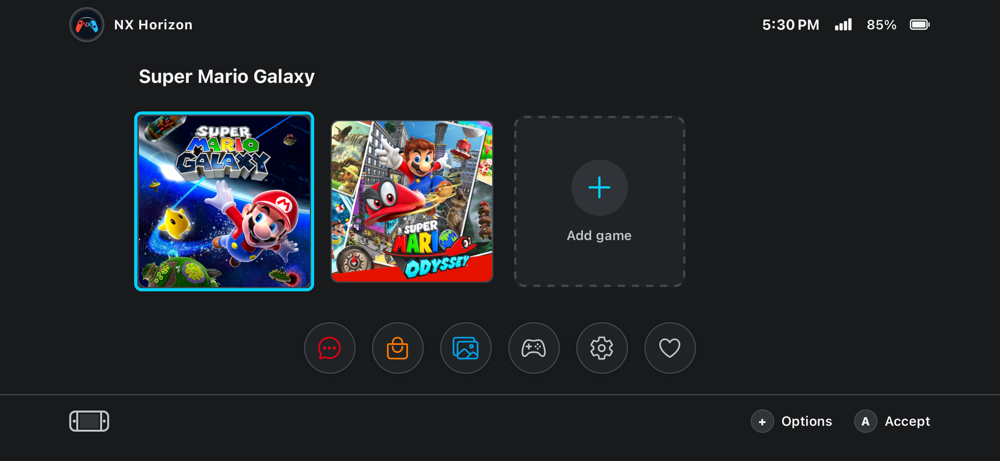
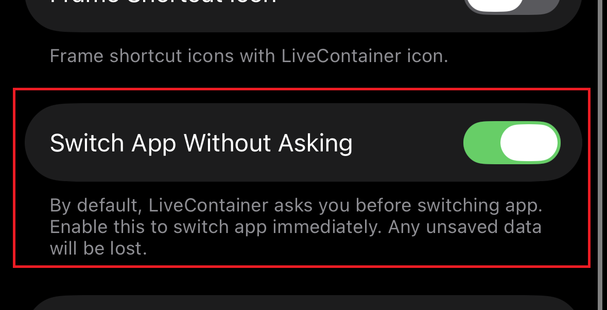
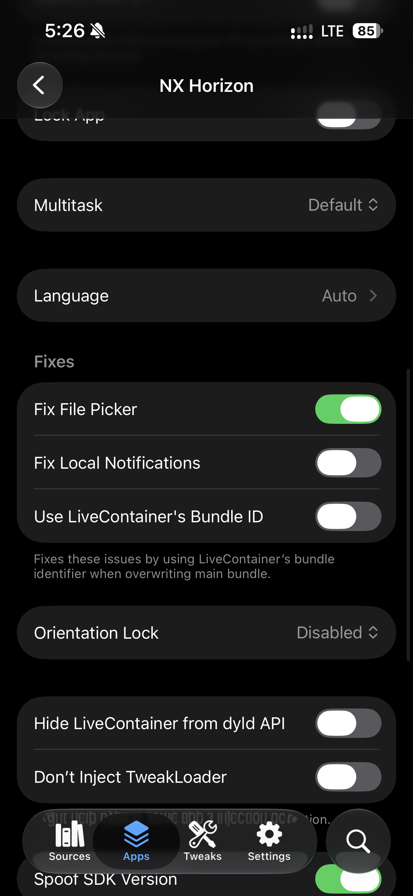
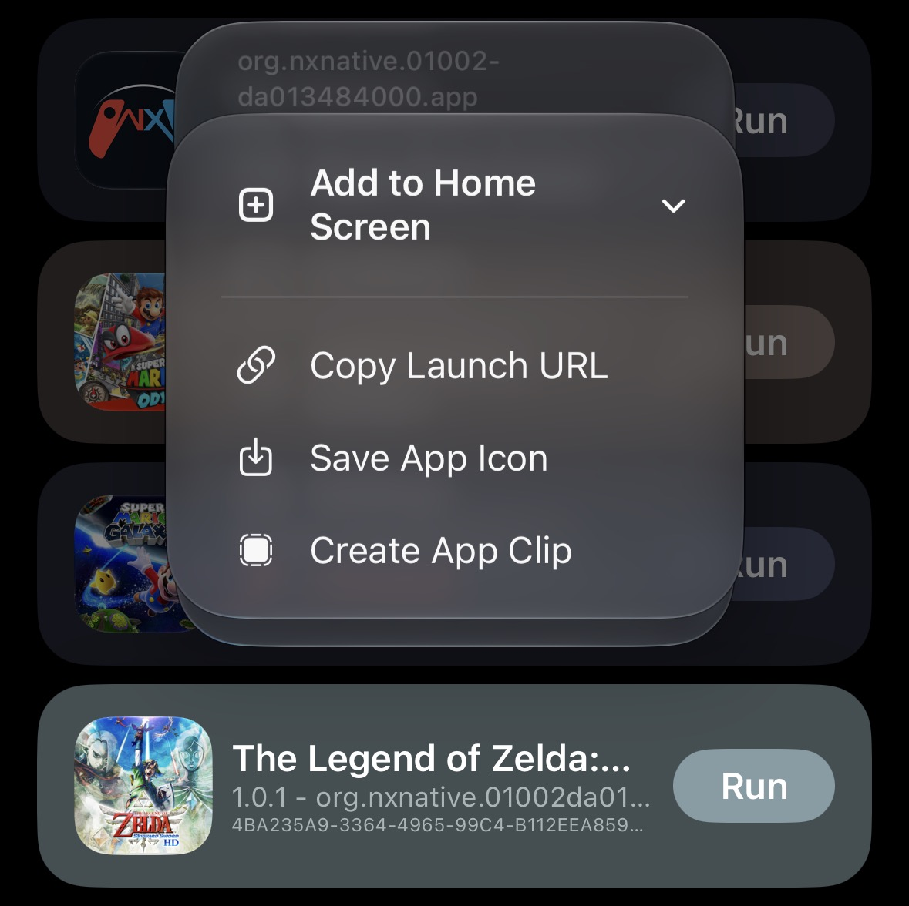
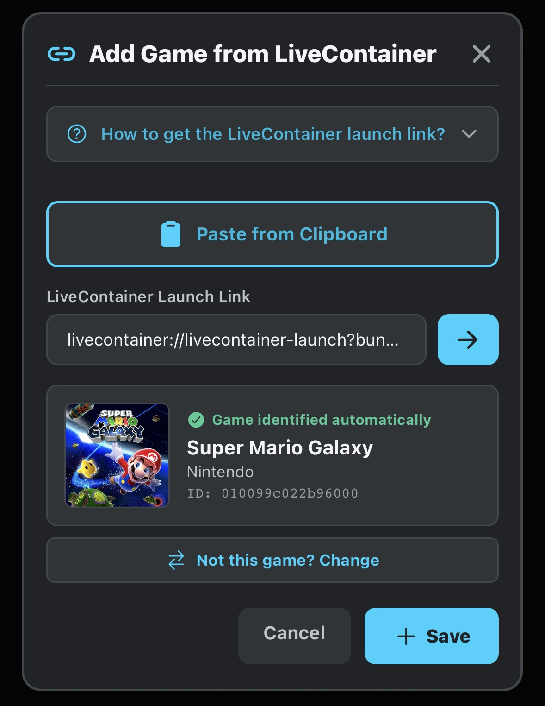
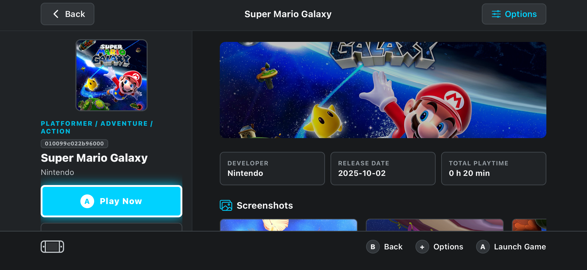
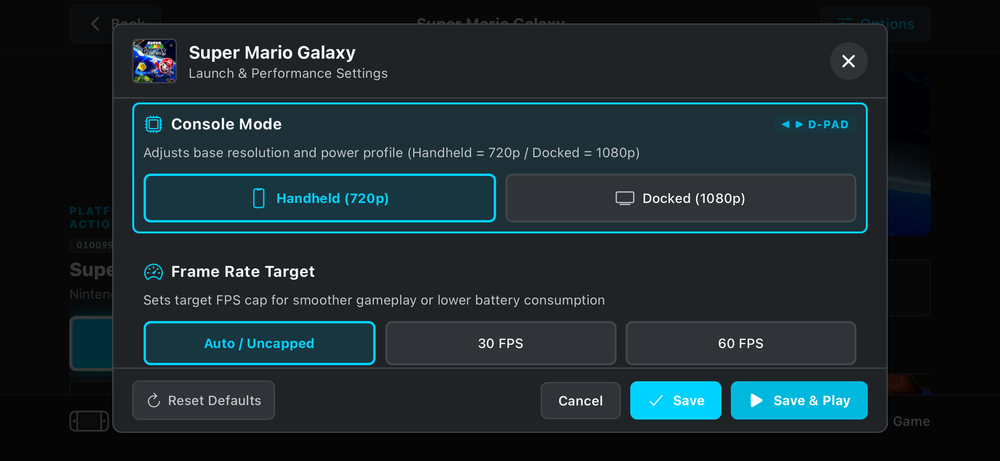
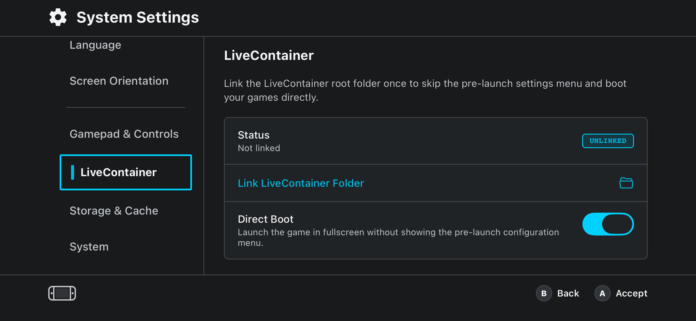

# NX Horizon

<div align="center">
  
  <p><em>Nintendo Switch Horizon OS frontend running compiled game ports on iPhone.</em></p>
</div>

NX Horizon is an experimental iOS launcher for Nintendo Switch game ports
compiled for iPhone with [NX2Apple](https://github.com/LNPANDY/NX2Apple), as
well as other iOS apps and games. It organizes entries in a console-inspired
library and can launch supported LiveContainer links, registered app URL
schemes, or an app's App Store listing.

NX Horizon is **not** an emulator, a game compiler, or a replacement for
NX2Apple or LiveContainer. It does not include games or game binaries.
NX2Apple game ports must be installed in LiveContainer to use their launch
links. Other iOS apps can be registered from the featured list or App Store
search; NX Horizon cannot detect installed apps or launch them by bundle ID,
so direct launch depends on an app-supported URL scheme. If that link is
unavailable, NX Horizon opens the app's App Store listing.

> **Experimental software:** expect incomplete features, compatibility issues,
> and breaking changes. Use it at your own discretion and do not rely on it as
> the only copy of your game metadata or configuration.

## Table of contents

- [How it works](#how-it-works)
- [Requirements](#requirements)
- [Getting started](#getting-started)
- [Recommended Setup: Install NX Horizon inside LiveContainer](#recommended-setup-install-nx-horizon-inside-livecontainer)
- [Installing games in LiveContainer](#installing-games-in-livecontainer)
- [Adding a game to NX Horizon](#adding-a-game-to-nx-horizon)
- [Game Details & Launching](#game-details--launching)
- [Per-Game Performance Settings](#per-game-performance-settings)
- [Console Settings & Direct Boot](#console-settings--direct-boot)
- [Building games with NX2Apple](#building-games-with-nx2apple)
- [Features](#features)
- [Installing with SideStore / AltStore Source](#installing-with-sidestore--altstore-source)
- [Building NX Horizon for iOS](#building-nx-horizon-for-ios)
- [Development](#development)
- [Project structure](#project-structure)
- [Contributing](#contributing)
- [Limitations and support](#limitations-and-support)

## How it works

The projects have separate responsibilities:

1. **NX2Apple** compiles a compatible game port into an iOS app package. Choose
   NX2Apple's **standalone IPA** output for each game; do not use the NX2Apple
   shell build.
2. **LiveContainer** imports and runs those standalone game IPAs on the device.
   The game must be installed inside LiveContainer for NX Horizon to launch it.
3. **NX Horizon** stores the LiveContainer launch URL and metadata for each
   port, and can also keep App Store metadata for ordinary iOS apps.

SideStore can sign and install iOS apps, but it is not the runtime or launch
bridge for games installed as separate apps. iOS does not provide NX Horizon a
public API to enumerate installed apps or launch an arbitrary app by bundle
identifier. NX Horizon can open a URL scheme only when the target app explicitly registers
and supports it. Bundle identifiers alone are not launch links. LiveContainer
provides the launch URL integration used for NX2Apple ports.

NX Horizon does not build, patch, or distribute game ports. Game compilation
and compatibility are handled by NX2Apple and the port itself.

## Requirements

### To use NX Horizon

- An iPhone or iPad capable of running the installed versions of NX Horizon and
  LiveContainer.
- [LiveContainer](https://github.com/LiveContainer/LiveContainer) installed
  and set up on the device.
- Game ports compiled by
  [NX2Apple](https://github.com/LNPANDY/NX2Apple) as standalone IPAs and
  imported into LiveContainer.
- A sideloading method such as [SideStore](https://github.com/SideStore/SideStore)
  to sign and install NX Horizon and LiveContainer, where required. SideStore
  installation of a game as a separate app does not make it launchable from
  NX Horizon.

Consult the official installation and compatibility documentation for
[LiveContainer](https://livecontainer.github.io/docs/installation) and
[SideStore](https://docs.sidestore.io/) for current device, iOS, signing, and
refresh requirements.

### To build NX Horizon from source

- macOS with Xcode and its command-line tools installed.
- [Node.js](https://nodejs.org/) and [pnpm](https://pnpm.io/).
- [CocoaPods](https://cocoapods.org/).

The build script uses the checked-in pnpm lockfile and generates the ignored
`ios/` directory with Expo prebuild.

## Getting started

1. Install and configure LiveContainer using its
   [official installation guide](https://livecontainer.github.io/docs/installation).
2. Build each supported game port with NX2Apple's **standalone IPA** output.
   Do not use the NX2Apple shell output.
3. Import each game IPA into LiveContainer. In its Apps view, tap the **+**
   button, select the IPA, and complete LiveContainer's import flow. This
   step is required: NX Horizon launches games through LiveContainer and
   cannot launch a game installed only as a separate SideStore app.
4. In LiveContainer, copy the launch URL for each installed game:
   - If the game has multiple containers, select the intended container first.
   - Long-press the game and choose **Add to Home Screen**.
   - Choose **Copy Launch URL**. This copies the launch URL; you do not need to
     create a Home Screen shortcut.
5. Open NX Horizon and open the import dialog. On the home screen, either swipe
   the game carousel to the far right and tap its dashed **Add game** tile, or
   tap the orange bag-shaped button in the bottom dock (the eShop-style
   shortcut). Both open the same dialog. In the Library screen, use the **+**
   button in the header.
6. Paste the copied LiveContainer URL. Review the detected game information
   and save it to the library.
7. Select the game in NX Horizon to launch it through LiveContainer.

For detailed LiveContainer instructions, see its
[Add to Home Screen / Copy Launch URL guide](https://livecontainer.github.io/docs/guides/add-to-home-screen).
The guide describes copying the URL independently of actually creating a
shortcut.

### Recommended Setup: Install NX Horizon inside LiveContainer

> [!TIP]
> **Best Experience:** We strongly recommend installing **NX Horizon directly inside the same LiveContainer instance** where your games are installed, rather than as a separate standalone app.

When installed inside LiveContainer:
- **Automatic Folder Linking (Zero Configuration):** LiveContainer provides its home path to launched apps through `LC_HOME_PATH`. NX Horizon uses it to detect LiveContainer's `Documents/Data/Application` directory on startup, so you do **not** need to select or link folders manually.
- **Seamless Launching:** The launcher transitions to your games instantly.

#### Essential LiveContainer Configuration:

1. **Global Settings in LiveContainer:**
   - Open LiveContainer Settings.
   - Enable **"Switch App Without Asking"**. This suppresses confirmation popups every time you launch a game from NX Horizon, providing a seamless console experience.

   <p align="center">
     
   </p>

2. **App Settings for NX Horizon inside LiveContainer:**
   - In LiveContainer's Apps list, tap or long-press **NX Horizon** to open its app settings.
   - Enable **"Fix File Picker"**. This ensures the iOS document picker operates reliably without crashes whenever file picking is used.

   <p align="center">
     
   </p>

---

### Link the LiveContainer folder (for standalone installations)

If you are running NX Horizon as a standalone sideloaded app (outside LiveContainer):
Basic launching uses the saved URL. Linking the LiveContainer folder in NX
Horizon is optional, but enables features that read or write a game's
configuration in its LiveContainer container.

You can link the folder during onboarding or later in **Settings →
LiveContainer → Link LiveContainer Folder**. In the iOS folder picker, select
the LiveContainer root folder and grant access. NX Horizon stores a
security-scoped folder reference on the device so it can locate game
containers. You can change or unlink this folder from the same settings
section. (Note: if installed inside LiveContainer, this is done automatically).

## Building games with NX2Apple

NX Horizon requires a separate standalone iOS app for each game port. Use the
instructions and compatibility notes in the
[NX2Apple repository](https://github.com/LNPANDY/NX2Apple), and select its
**standalone IPA** build mode.

Do **not** select the NX2Apple shell build for use with NX Horizon. The shell
is NX2Apple's own launcher environment; NX Horizon instead imports individual
standalone game IPAs into LiveContainer and stores their LiveContainer launch
URLs.

NX2Apple is maintained separately. NX Horizon cannot convert a game, create
an IPA from a ROM, or make an incompatible port run.

Here, **standalone IPA** describes the game package format produced by
NX2Apple, as opposed to its shell build. It does not mean that NX Horizon can
launch the game after it is installed separately on the iOS Home Screen. The
standalone IPA must still be imported into LiveContainer for NX Horizon's
launch integration to work.

## Installing games in LiveContainer

Use the official
[LiveContainer installation guide](https://livecontainer.github.io/docs/installation)
to install LiveContainer and set up its signing method. To import a compiled
game:

1. Open LiveContainer and go to its **Apps** view.
2. Tap **+** and select the game's standalone IPA.
3. Follow LiveContainer's prompts to install/import the app.
4. Launch the imported game once from LiveContainer if needed, then copy its
   launch URL: long-press the game, choose **Add to Home Screen**, and tap **Copy Launch URL**:

<p align="center">
  
</p>

NX Horizon does not embed LiveContainer or install game IPAs itself. Both
NX Horizon and LiveContainer must be installed separately on the device. A
game installed directly through SideStore (or another sideloading tool) as its
own iOS app is outside NX Horizon's supported launch flow; launch that app
from iOS instead.

## Adding a game to NX Horizon

1. Open the import dialog from the dashed **Add game** tile at the far right of
   the home carousel, the orange eShop-style bag button in the home dock, or
   the **+** button in the Library header.
2. Select a featured app, search the App Store, or paste a LiveContainer URL.
3. Review the metadata and artwork preview. For an unrecognized LiveContainer
   app, enter a title manually.
4. Save the entry. The carousel's dashed tile and the dock button both open this
   same import dialog.

<p align="center">
  
</p>

When a URL contains a Nintendo Switch title ID, NX Horizon attempts to retrieve
metadata and artwork from the NLib API and can fall back to its bundled
catalog. NLib provides lookup by Title ID; its documented API does not provide
search by game name. When a URL has no Title ID, NX Horizon searches its
curated on-device catalog. If the search returns multiple plausible games, it
asks you to choose instead of silently assigning the first result. A custom
LiveContainer app can also be added with a manually entered name. Ordinary
iOS apps can be searched through Apple's public App Store lookup API. When an
imported LiveContainer link's bundle ID matches an App Store result, NX Horizon
uses the same store metadata. Metadata lookup requires network access; saved
metadata and launch links are stored locally with the library entry.

Use **Edit app** in the detail view to customize its displayed name,
description, cover image, and launch URL. Custom themes in **Settings →
Appearance** support a background image and color palette.

Metadata coverage is incomplete: NX Horizon does not currently recognize
every Nintendo Switch title automatically. The local catalog and detection
rules are still being improved. If a game is missing or detected incorrectly,
please open an issue with the launch URL's Title ID (when available), the
search term, and the result you expected. Do not attach game files or other
copyrighted content.

An app without a compatible launch URL can still be saved and opened through
its App Store listing. A bundle identifier does not enable direct launching of
a separately installed iOS app.

## Game Details & Launching

Selecting any game from the home carousel or library opens its detailed view. Here you can inspect high-resolution banner artwork, publisher info, release date, categories, and a synchronized bilingual synopsis (in Spanish or English according to your active console language):

<p align="center">
  
</p>

## Per-Game Performance Settings

Tap **Configuration** on a supported NX Native port (`org.nxnative.*`) to
fine-tune port-specific performance parameters written to its LiveContainer
container (`env.txt`). This configuration is not available for ordinary iOS
apps or games:
- **Operation Mode:** Toggle between Handheld (720p portable profile) and Docked (1080p profile).
- **Target Frame Rate:** Limit or uncap frame rate (Auto / 30 FPS / 60 FPS).
- **Apple Metal Performance HUD:** Display real-time FPS, GPU load, and memory usage overlay.
- **Motion Controls:** Enable device gyroscope and accelerometer simulation for motion-enabled games.
- **Game Language:** Force game locale independently (`es-ES`, `en-US`, `ja-JP`, etc.).

<p align="center">
  
</p>

## Console Settings & Direct Boot

In the console settings screen, you can manage system-wide launcher preferences:
- **LiveContainer Status:** Automatically detects access to LiveContainer's game containers (`Data/Application`) when available.
- **Direct Boot (`DM_LAUNCHER=0`):** Boots supported NX Native packages into fullscreen without the LiveContainer menu appearing.
- **Controller Diagnostics:** Interactive visual gamepad tester and launcher stick deadzone calibration (prevents menu drift).
- **Bilingual Interface:** Switch between Spanish and English on the fly.

<p align="center">
  
</p>

## Features

- Portrait and landscape layouts, with a landscape console-inspired home
  screen.
- Game carousel and searchable library with favorites and recently played
  entries.
- Game metadata, artwork, play-time tracking, and manual title entry.
- LiveContainer URL launching and automatic container folder detection.
- Per-game launch settings for supported ports, including operation mode
  (Handheld 720p / Docked 1080p), frame-rate target, Metal HUD, motion, and language.
- Optional direct-boot configuration that writes supported launch settings to
  the linked LiveContainer game container.
- Bluetooth/game controller status, button input test, and launcher stick deadzone controls.
- English and Spanish UI translations.
- Automatic, light, and dark appearance modes.

Feature availability depends on the device, the generated iOS build, the
installed LiveContainer version, and the game port.

## Installing with SideStore / AltStore Source

You can add NX Horizon directly to **SideStore** or **AltStore** to receive automated updates:

1. In SideStore/AltStore, go to the **Sources** tab.
2. Tap the **+** button in the top right.
3. Add the source URL:
   ```text
   https://raw.githubusercontent.com/CesarGarza55/NXHorizon/main/apps.json
   ```
4. You can also tap this one-click link on your iOS device to add it automatically:
   
   [](https://altdirect.app/?url=https://raw.githubusercontent.com/CesarGarza55/NXHorizon/main/apps.json&r=sidestore)

   *(Direct deep-link for copy-pasting into Safari: `sidestore://source?url=https://raw.githubusercontent.com/CesarGarza55/NXHorizon/main/apps.json`)*

---

## Automated GitHub Actions CI/CD

NX Horizon includes an automated GitHub Actions compilation and release workflow (`.github/workflows/build-and-release.yml`):

- **Automatic Version Detection:** On push to `main`, the workflow reads the version from `package.json` and checks if a corresponding Git tag (`v<version>`) already exists.
- **On-Demand Compilation:** If a new version is detected, a `macos-latest` runner compiles the unsigned IPA (`build.sh`), calculates SHA256 checksums, dynamically updates `apps.json`, and publishes an official GitHub Release with assets attached.

---

## Building NX Horizon for iOS

From the repository root on macOS, run:

```sh
./build.sh
```

The script:

1. Installs JavaScript dependencies with `pnpm install --frozen-lockfile`.
2. Regenerates the iOS project with `expo prebuild`.
3. Installs CocoaPods dependencies.
4. Archives the app in Release configuration with code signing disabled.
5. Packages the `.app` into an unsigned IPA.

The resulting file is:

```text
build/NXHorizon-unsigned.ipa
```

The `/build` directory is ignored by Git. The IPA is intentionally unsigned
and has no provisioning profile; it is **not directly installable** on iOS.
Sign it with SideStore or another compatible sideloading tool before
installation. No Apple Team ID or signing credentials are required by the
repository build script.

The generated `ios/` project is also ignored and is recreated by the script.
Local changes made directly in `ios/` will be discarded by the clean prebuild;
use Expo config or config plugins for persistent native changes.

## Development

Install dependencies:

```sh
pnpm install --frozen-lockfile
```

Start the Expo development server:

```sh
pnpm start
```

Build and run the native iOS app on a configured simulator or device:

```sh
pnpm ios
```

This development command may use Xcode signing for a connected physical
device. For a distribution-style unsigned Release IPA, use `./build.sh`
instead.

Run the available repository checks:

```sh
pnpm exec tsc --noEmit
pnpm run verify-i18n
bash -n build.sh
```

## Project structure

```text
.
├── App.tsx                    # App entry point and top-level screen composition
├── app.json                   # Expo and iOS configuration
├── assets/                    # App icon and splash assets
├── build.sh                   # Unsigned iOS Release IPA build
├── modules/
│   ├── nx-gamecontroller/     # Native game controller module
│   └── nx-livecontainer/      # Native LiveContainer integration
├── plugins/                   # Expo config plugins
├── scripts/                   # Repository maintenance and validation scripts
└── src/
    ├── components/            # Library, Switch-inspired UI, and dialogs
    ├── hooks/                 # React hooks, including game controller state
    ├── i18n/                  # English and Spanish translations
    ├── screens/               # Settings and game details
    ├── services/              # Metadata lookup and LiveContainer URL parsing
    ├── state/                 # Local library and focus stores
    ├── theme/                 # Appearance provider and color palettes
    └── types/                 # Shared TypeScript types
```

The game library, preferences, and launch settings are stored on-device using
AsyncStorage. Game metadata and artwork may be requested from the configured
metadata service when a title is added or refreshed.

## Contributing

Contributions are welcome. NX Horizon is experimental, so discuss substantial
behavior or architecture changes in an issue before investing in a large pull
request.

1. Search existing issues and pull requests before opening a new one.
2. For a bug report or a title that is missing or detected incorrectly, include
   the device model, iOS version, NX Horizon build, LiveContainer version,
   steps to reproduce, the launch URL's Title ID when available, and the
   incorrect or expected result. Do not include signing credentials, private
   game files, or personal data.
3. For a feature request, describe the user problem and how the change fits
   NX Horizon's role as a launcher rather than a game compiler or runtime.
4. Fork the repository and create a focused branch for your change.
5. Follow the existing TypeScript, React Native, and Expo patterns. Keep
   platform-specific behavior in native modules or Expo config plugins rather
   than editing generated `ios/` files.
6. Keep UI text in both `src/i18n/locales/en.json` and
   `src/i18n/locales/es.json`.
7. Run the relevant checks before opening a pull request:

   ```sh
   pnpm exec tsc --noEmit
   pnpm run verify-i18n
   bash -n build.sh
   ```

8. Open a pull request with a concise description, the reason for the change,
   validation performed, and screenshots for visible UI changes when possible.

Keep pull requests scoped and avoid bundling game IPAs, signing identities,
provisioning profiles, or generated native build output.

## Limitations and support

- NX Horizon is an experimental launcher, not a Nintendo product and not
  affiliated with Nintendo, NX2Apple, LiveContainer, or SideStore.
- Game compilation, game compatibility, and LiveContainer behavior are outside
  this repository's control. Report issues to the project responsible for the
  failing component when appropriate.
- NX Horizon does not distribute games, ROMs, keys, or game IPAs. Only use
  software and files you are authorized to use.
- Launching through NX Horizon requires a valid LiveContainer URL and a
  compatible LiveContainer/game setup. A game installed separately through
  SideStore is not directly launchable from NX Horizon; iOS does not expose a
  public arbitrary-app launch API by bundle identifier, and NX Horizon does
  not currently implement game-specific URL schemes.
- Title-name matching when a LiveContainer URL does not include a recognizable
  Title ID is limited to the bundled curated catalog. NLib lookup by Title ID
  can provide metadata for IDs outside that catalog, but NLib's documented API
  does not support searching titles by name.
- Linking the LiveContainer folder is needed for container-based configuration
  features, but not for opening a saved launch URL.
- The project currently focuses on iOS. The presence of Expo cross-platform
  tooling does not imply that every native integration works on Android or web.

For support, open an issue in this repository with enough information to
reproduce the problem, after checking the relevant
[NX2Apple](https://github.com/LNPANDY/NX2Apple),
[LiveContainer](https://github.com/LiveContainer/LiveContainer), or
[SideStore](https://github.com/SideStore/SideStore) documentation.

## Disclaimer

NX Horizon is an independent experimental project and is not affiliated with,
authorized, sponsored, or endorsed by Nintendo. Nintendo and Nintendo Switch
are trademarks of Nintendo. All game names and related marks belong to their
respective owners. NX Horizon does not provide or distribute Nintendo games or
game files.
